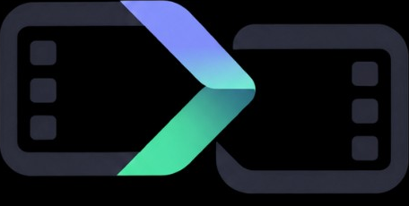
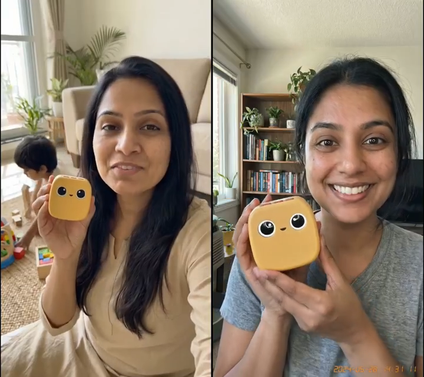
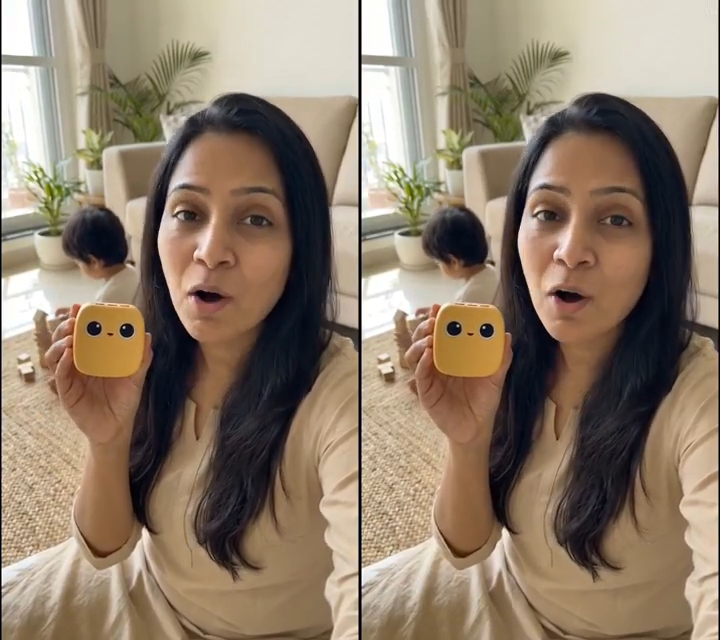
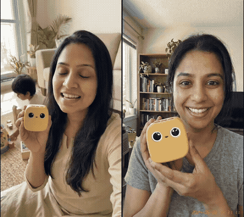

# graft

[](https://github.com/eonik-ai/graft/actions/workflows/ci.yml)



A compiler for versioned ads. Hosts write a recipe — slots, overlap joins,
and a look graph. graft rebuilds the dirty working nodes and encodes
delivery once.

It is not an editor and it is not [eonik](https://www.eonik.ai/). eonik is a
host that should call this compiler. Premiere, Resolve, and DaVinci can
become guests later the way Maya sits on USD: compile-out, lossy import, a
loss report. They are not lossless plugins. See [adapters](docs/adapters.md).

[Mission](docs/mission.md) · [Schema](schema/) · [Hosts](docs/hosts.md) ·
[Install](docs/install.md)

## Example

A host binds ranges on a library clip. `composition.json` is the recipe;
named `hook.mov` files are a crutch. Essence is not in git; these stills
are compiled dests (the README stills were cut from named takes of one
product clip).

```
takes/
  product.mp4
  composition.json # dest, slots[] file+in/out or scion, nests, joins, graph
  sfx.wav          # optional overlay on dest time
  vo.wav bed.wav
  look.cube        # optional lut3d after the join
```

```
$ graft ship --out ad.mp4
reuse  scion=9x16  encode=8.55s
dirty  hook, body, cta
kerf   hook→body
kerf   body→cta
out    ad.mp4

$ graft swap hook ./takes/product.mp4 --in 6 --src-out 7 --out ad-v2.mp4
reuse  scion=hook-v2-2  encode=3.20s
dirty  hook
kerf   hook→body
clean  body  blake3:2fdbc0bf2b68  hit
clean  cta  blake3:12ea2e560871  hit
out    ad-v2.mp4
```

Hook at 0.5s — left is dest v1, right is dest v2 after the swap:



Body at 3.4s — same encode on both dests (`body` was a cache hit):





Rebuild the stills from local files: `HOOK= BODY= CTA= HOOK2= make readme-example`.
`ship` fails if ffmpeg is missing or the takes are not real media.
`swap` fails if a sibling slot recodes.

## What a host does

A host (an app, this CLI, later a guest NLE) keeps:

- a **score** — named slots (`hook`, `body`, `cta`, …) on one clock
- **scions** — variants of those bindings (new hook, new dest, new language)
- **essence** — library clips, stored by hash, never rewritten

graft flattens the selected scion, normalizes dirty sources to working
depth, folds joins (`concat` / `xfade`), runs `scion.graph` (LUT, …),
and encodes delivery once. A later hook swap must not recode a clean
body source. The look stays on the child: `graph: null` inherits the
parent graph. `graft swap look` writes a graph override. Preview is
the same compile, not a second concatenator.

The machine contract is JSON Schema in [`schema/`](schema/). The Rust
entry a host calls is `graft_compile::compile` (see [hosts](docs/hosts.md)).
The `graft` binary is a reference host, not the product.

Today no app other than this CLI compiles through those crates.

## What it cannot do

It does not open a timeline, guess slots from pixels, invent a replacement
clip, or round-trip NLE effects and grades. It is not git-on-pixels, a
lock server, a DAM, or a review tool. crates.io crate name `graft` is a
different project; do not `cargo install graft` from crates.io.

## Reference CLI

Runtime: **ffmpeg** and **ffprobe** on `PATH` (or `$FFMPEG` / `$FFPROBE`).
graft shells out; it does not link GPL x264.

```sh
mkdir ad && cd ad
# takes/composition.json slots[] bind ranges on a library clip
graft ship --out ad.mp4
graft swap hook ./takes/product.mp4 --in 6 --src-out 7 --out ad-v2.mp4
graft swap look ./takes/look-v2.cube --out ad-look.mp4
graft swap eq ./takes/eq.json --out ad-eq.mp4
```

`graft compile` on the JSON examples in this repo stays plan-only —
those fixtures have placeholder hashes, not media.

`graft address --kind hook_rate --build <id>` names the slot a metric
hits, plus covering graph nodes. It does not talk to Ads Manager.

Plumbing (`init`, `bind`, `scion`, `compile`, `signal`, `iterate`) is
what porcelain calls. [loop.md](docs/loop.md) is the walk.

## Install

**macOS (Homebrew)** — this repo is the tap:

```sh
brew trust --tap eonik-ai/graft
brew tap eonik-ai/graft https://github.com/eonik-ai/graft
brew install graft
```

**Linux / macOS binary:**

```sh
curl -fsSL https://raw.githubusercontent.com/eonik-ai/graft/main/scripts/install.sh | sh
```

GitHub Releases ship macOS arm64 and Intel, Linux gnu (amd64 and arm64),
Linux musl (amd64), and `.deb` packages. Nix: `nix run github:eonik-ai/graft`.

From source (Rust 1.85+, `rustup`):

```sh
cargo install --git https://github.com/eonik-ai/graft.git --locked --bin graft
graft --version
```

A host that embeds the compiler depends on the crates from this git
remote (`graft-score`, `graft-cas`, `graft-compile`). They are
`publish = false`. Details: [docs/install.md](docs/install.md).

From a clone:

```sh
git clone https://github.com/eonik-ai/graft.git
cd graft
make test
```

`.graft/` is local CAS and builds; do not commit it. Recipe history is Git.

## Guests

| Guest | Today |
| --- | --- |
| OTIO | Sidecar keeps `graph` / overlays / joins / markers; import writes those onto the score; native effects stay lost |
| FCPXML, Premiere, Resolve, DaVinci, CapCut | Not implemented. Export would flatten slots to a timeline; import is best-effort. [Loss matrix](docs/adapters.md) |

## Also

| | |
|---|---|
| Why it exists | [Mission](docs/mission.md) · [principles](docs/principles.md) |
| Embed | [hosts](docs/hosts.md) · [architecture](docs/architecture.md) |
| CLI walk | [loop](docs/loop.md) · [install](docs/install.md) |
| Compiler | [cache and kerfs](docs/compile.md) · [time map](docs/time-map.md) |
| Contract | [JSON Schema](schema/) · [worked example](examples/hook-v3-body-v1-9x16/) |
| Boundaries | [nearby tools](docs/comparison.md) · [adapter loss](docs/adapters.md) |

## License

Copyright 2026 [eonik](https://www.eonik.ai/) ([github.com/eonik-ai](https://github.com/eonik-ai)).

Licensed under the [Apache License, Version 2.0](LICENSE).
The patent grant is why this project is Apache-2.0, not MIT.
There is no CLA. You keep copyright on your patches; DCO + Apache §5
license them inbound. See [NOTICE](NOTICE) and [CONTRIBUTING.md](CONTRIBUTING.md).
